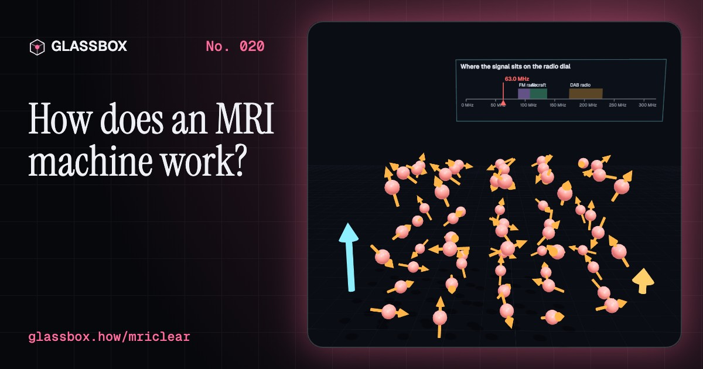
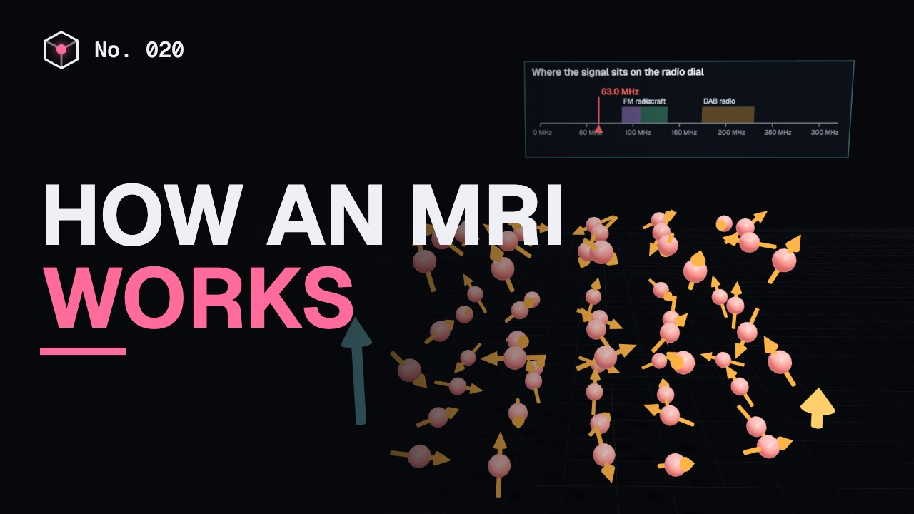
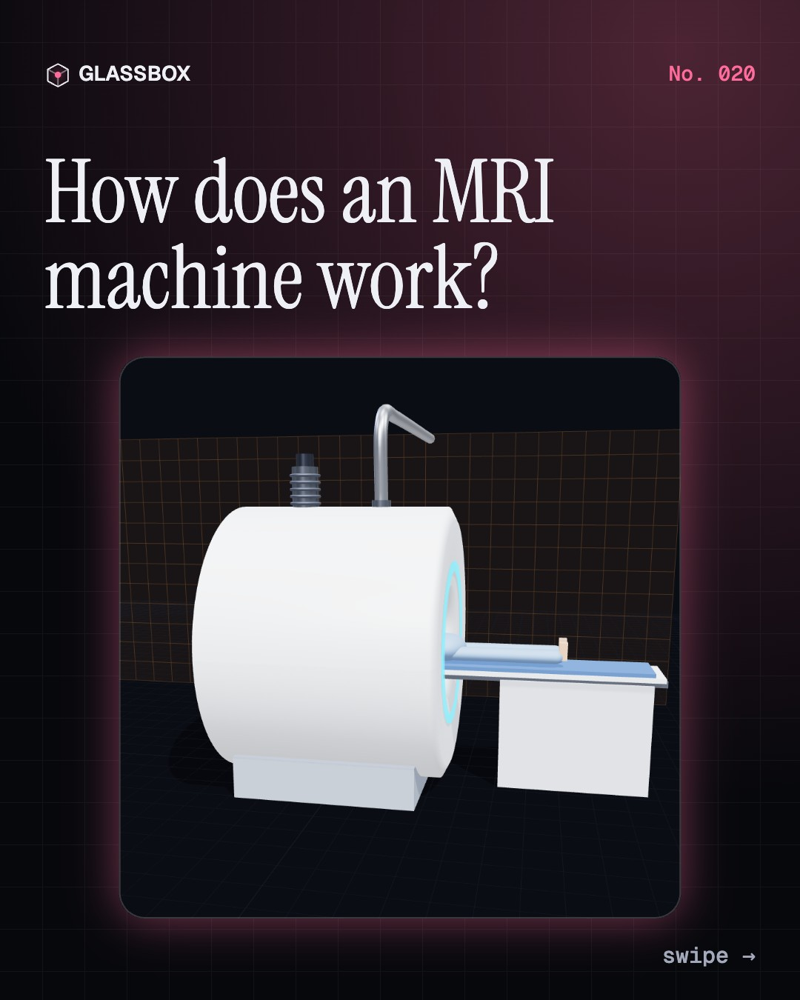
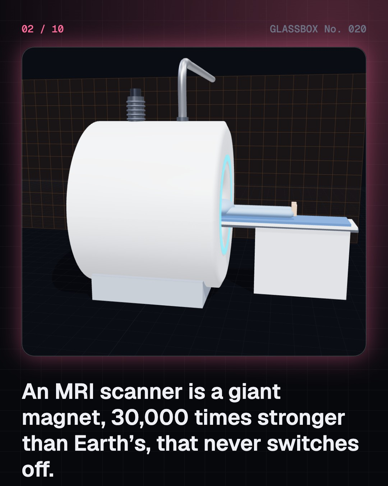
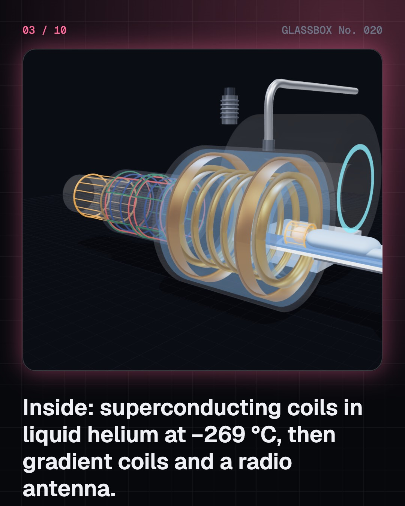
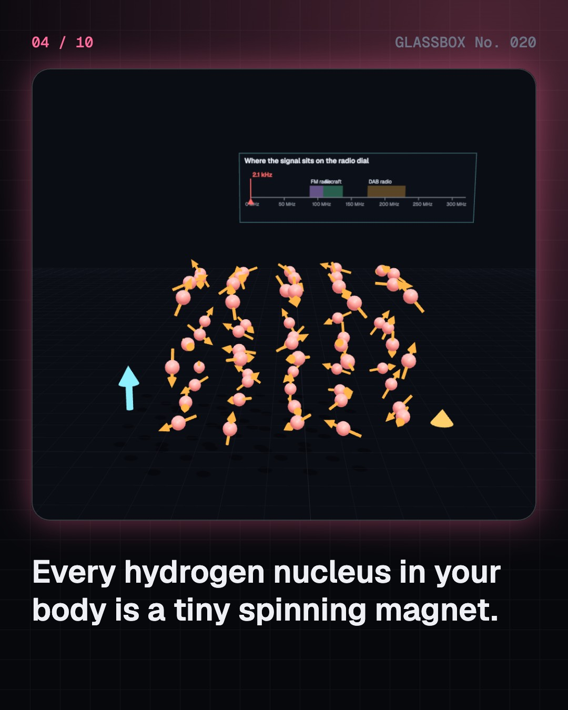

<!-- glassbox:start -->
<!-- Generated from glassbox.json by the Glassbox hub (npm run readme -- mriclear). Edit glassbox.json, not this block. -->
<p align="center"><a href="https://glassbox.how/e/mriclear/"></a></p>

<h1 align="center">MRIClear</h1>

<p align="center"><b>How does an MRI machine work?</b><br>A magnet 30,000 times stronger than Earth's, a radio that listens to the hydrogen in your body, and a Fourier transform that turns echoes into a picture. Take an MRI scanner apart in 3D and make T1 and T2 contrast yourself.</p>

<p align="center"><a href="https://glassbox.how/mriclear/"><b>▶ Play with it</b></a> &nbsp;·&nbsp; <a href="https://glassbox.how/e/mriclear/">Read the 60-second explainer</a> &nbsp;·&nbsp; <a href="https://glassbox.how/mriclear/glassbox/reel.mp4">Watch the 40-second video</a></p>

<p align="center">
  <a href="https://glassbox.how/e/mriclear/"></a>
  <a href="https://glassbox.how/e/mriclear/"></a>
  <a href="LICENSE"></a>
  <a href="LICENSE-CONTENT.md"></a>
  <a href="#privacy"></a>
</p>

## In 60 seconds

1. **A giant magnet that never switches off.** An MRI scanner is a superconducting magnet: coils of niobium-titanium wire bathed in liquid helium at about −269 °C, carrying current with no resistance. It makes a field of 1.5 or 3 tesla, 30,000 to 60,000 times Earth's, inside a tunnel about 70 cm wide.
2. **Your hydrogen nuclei are tiny magnets.** Each hydrogen nucleus is a spinning proton that acts like a bar magnet. In the scanner a tiny excess, about 5 in a million at 1.5 T, lines up with the field, and every one of them wobbles at the Larmor frequency: 42.58 MHz per tesla, or 63.9 MHz at 1.5 T.
3. **A radio pulse, then an echo.** A burst of radio waves at exactly that frequency tips the spins sideways, and as they spin they broadcast a faint radio signal. It fades as the spins drift out of step (T2) while they slowly realign with the field (T1). Different tissues do this at different rates, and the timing of the pulses, TR and TE, decides which tissues look bright.
4. **Tilting the field to find position.** Gradient coils make the field slightly stronger on one side, so each position sings at its own frequency. Each echo fills one line of k-space, and a Fourier transform turns the full grid into the picture. The coils flex as they switch, which makes the loud knocking.
5. **No X-rays, but the magnet is always on.** MRI uses no ionising radiation. Its dangers are steel objects pulled into the bore, implants that can move or heat up, and radio heating, which is kept under set limits. Everyone is screened before going in, and in an emergency the magnet can be quenched, venting its helium up a pipe.
6. **It can watch the brain work.** fMRI detects the extra oxygen-rich blood that flows to busy brain areas, diffusion MRI follows water along nerve fibres, and angiography lights up flowing blood. MRI is best for soft tissue; CT is quicker and better for bone and emergencies.

## Words worth knowing

| Term | Meaning |
|---|---|
| **Tesla** | The unit of magnetic field strength. Earth's field is about 0.00005 T; hospital scanners are 1.5 or 3 T. |
| **Superconductor** | A material that, when cold enough, carries current with zero resistance, so the magnet stays on without a power supply. |
| **Precession** | The wobble of a spinning proton round the direction of the magnetic field. |
| **Larmor frequency** | How fast protons precess: 42.58 MHz for every tesla of field. |
| **RF pulse** | A short burst of radio waves at the Larmor frequency that tips the spins over. |
| **T1 and T2** | How quickly magnetisation grows back along the field (T1) and how quickly the sideways signal fades (T2). Every tissue has its own. |
| **Gradient coils** | Three coils that make the field vary with position, so the scanner can tell where each signal came from. |
| **k-space** | The grid of raw echo data. A Fourier transform turns it into the image. |
| **BOLD** | Blood-oxygen-level-dependent signal: the change fMRI uses to see which brain areas are working. |

## A short history

**From an Irish physicist's wobbling charges in 1897 to 11.7-tesla images of the living brain.**

- **1938** · Resonance in a beam of molecules (Isidor Rabi and colleagues, New York, USA)
- **1946** · NMR in ordinary matter (Edward Purcell and Felix Bloch, Cambridge, Massachusetts and Stanford, USA)
- **1950** · The spin echo (Erwin Hahn, Urbana, Illinois, USA)
- **1971** · Tumours relax more slowly (Raymond Damadian, Brooklyn, New York, USA)
- **1973** · The first MR image (Paul Lauterbur, Stony Brook, New York, USA)
- **1977** · Indomitable scans a person (Raymond Damadian and his team, Brooklyn, New York, USA)
- **1980** · The first useful patient scan (John Mallard's team, Aberdeen, Scotland)
- **1990** · Blood oxygen lights up the brain (Seiji Ogawa and colleagues, Murray Hill, New Jersey, USA)

The full story, with 29 moments, charts, people and 61 sources: [glassbox.how/e/mriclear/history](https://glassbox.how/e/mriclear/history/). The data lives in [`history.json`](history.json).

## Video and slides

Made with the Glassbox studio from this box's storyboard (`window.glassbox.director`). Free to reuse under CC BY 4.0.

<a href="https://glassbox.how/mriclear/glassbox/video.mp4"></a>

<p><a href="glassbox/slide-1.jpg"></a> <a href="glassbox/slide-2.jpg"></a> <a href="glassbox/slide-3.jpg"></a> <a href="glassbox/slide-4.jpg"></a></p>

| File | What | Size |
|---|---|---|
| [`glassbox/reel.mp4`](https://glassbox.how/mriclear/glassbox/reel.mp4) | Reel / Short, with captions and soundtrack | 1080×1920 |
| [`glassbox/video.mp4`](https://glassbox.how/mriclear/glassbox/video.mp4) | YouTube video, with captions and soundtrack | 1920×1080 |
| `glassbox/slide-1…10.jpg` | Instagram carousel | 1080×1350 |
| `glassbox/thumb.jpg` | YouTube thumbnail | 1280×720 |
| `glassbox/cover.jpg` | Share card and repo social preview | 1200×630 |
| [`glassbox/history-reel.mp4`](https://glassbox.how/mriclear/glassbox/history-reel.mp4) | “History in 10 moments” Reel / Short | 1080×1920 |
| `glassbox/history-slide-*.jpg` | History carousel | 1080×1350 |
| `glassbox/post.json` | Post copy and schedule used by the publish kit | |

## Privacy

This box has no accounts and no ads, and it ships its own fonts and libraries. When you run it yourself it sends nothing anywhere. On glassbox.how, the site's `/bar.js` also loads Glassbox's analytics: **Google Analytics** to count visits (it asks first in the EU, UK and Switzerland, and stays off when your browser sends Global Privacy Control or Do Not Track) and **ClickTrust** to detect bots.

It remembers a few things **in your own browser only**, and never sends them anywhere:

| Browser storage key | What it holds |
|---|---|
| `mriclear.v1` | Which chapters you have opened, your best quiz scores, and sound on or off. |

Exactly what each one sees is at [glassbox.how/privacy](https://glassbox.how/privacy/).

## Licences

- **Code:** [MIT](LICENSE). Use it, change it, ship it.
- **Explanations, text, images and videos** (`glassbox.json`, `glassbox/`): [CC BY 4.0](LICENSE-CONTENT.md). Credit “Glassbox, glassbox.how/e/mriclear”.
- **Third-party parts** keep their own licences: [three.js](https://threejs.org) (MIT), [Geist, Instrument Serif](https://openfontlicense.org) (SIL OFL 1.1).
- The Glassbox name and logo aren't covered by either licence. See the [terms](https://glassbox.how/terms/).

Found a mistake? [Open an issue](https://github.com/bdeeps/mriclear/issues). Corrections happen in public.
<!-- glassbox:end -->

## Run it

It's plain HTML, CSS and JavaScript. No build step and no dependencies. Run locally, it contacts no other website.

```bash
python3 -m http.server 8000
```

Three.js and the fonts ship in `vendor/` and `fonts/`, so it also works offline.

Then open http://localhost:8000.

## How it's built

| File | What |
|---|---|
| `index.html`, `css/app.css` | The page and its styles |
| `js/app.js`, `js/stage.js`, `js/ui.js`, `js/kit.js` | The shared Glassbox 3D engine: chapters, 3D stage, controls, quiz, video director |
| `js/mri.js` | MRIClear's shared physics and parts: proton constants, tissue T1/T2 values, the spin-echo signal, a 2D FFT, the brain phantom, the fringe-field model and the scanner builders |
| `js/chapters/*.js` | One file per chapter: the 3D model, controls, text, key terms, quiz and video scenes |
| `glassbox.json` | Title, question, explainer beats, key terms, browser storage and credits shown on glassbox.how |
| `reel` in each chapter | The storyboard the Glassbox studio records into short videos |
| `glassbox/` | The published video, slides, thumbnail and post copy |
| `fonts/`, `vendor/three/` | Self-hosted Geist and Instrument Serif (SIL OFL 1.1) and three.js (MIT) |
